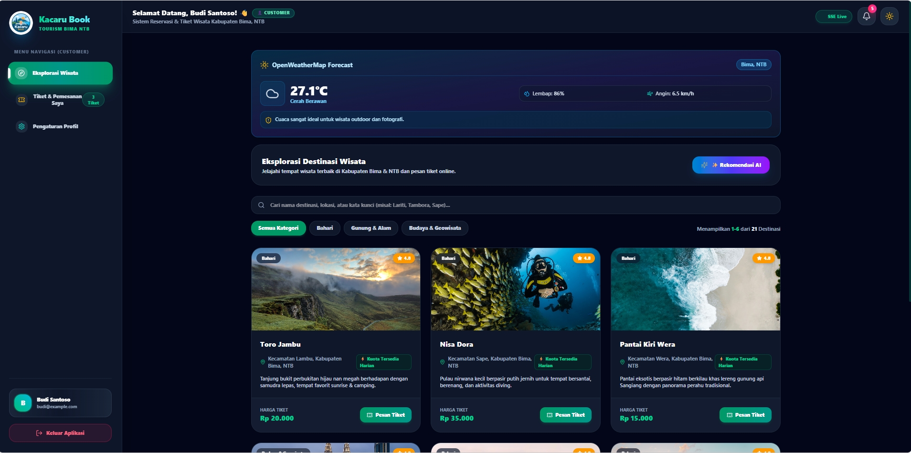
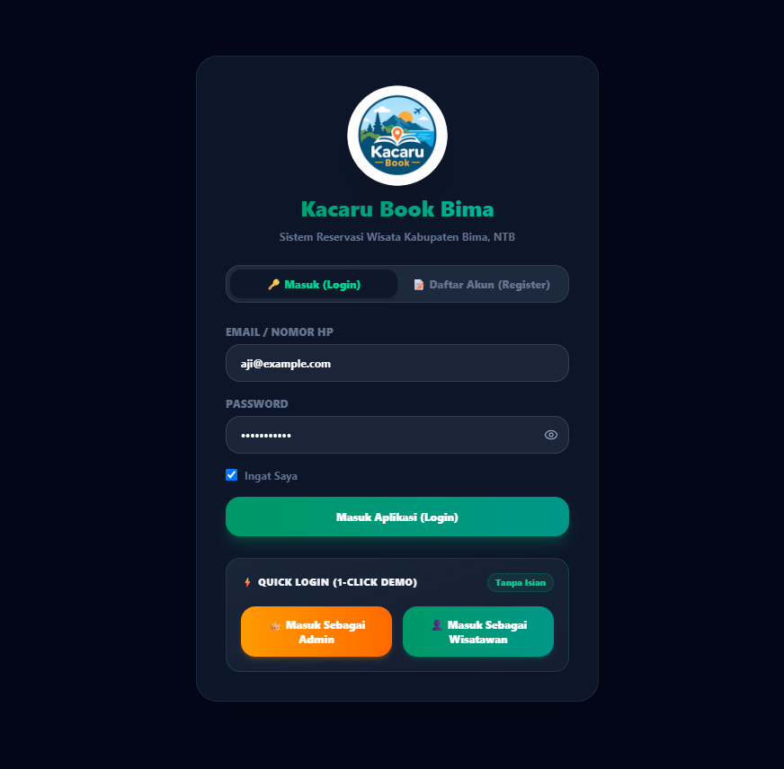
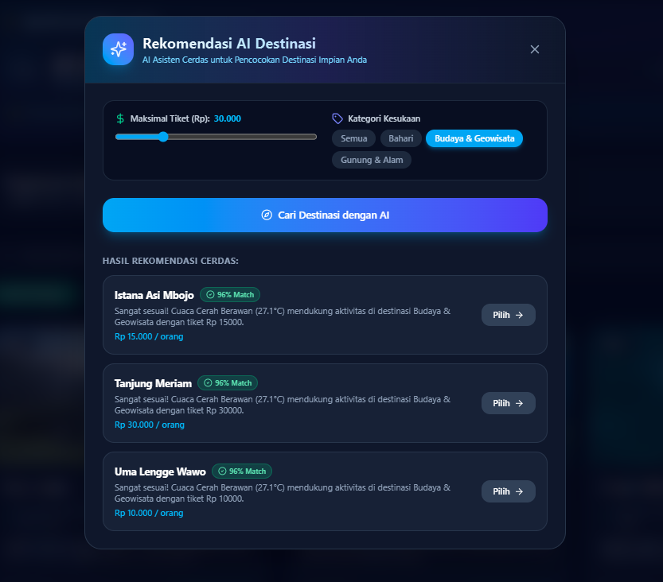
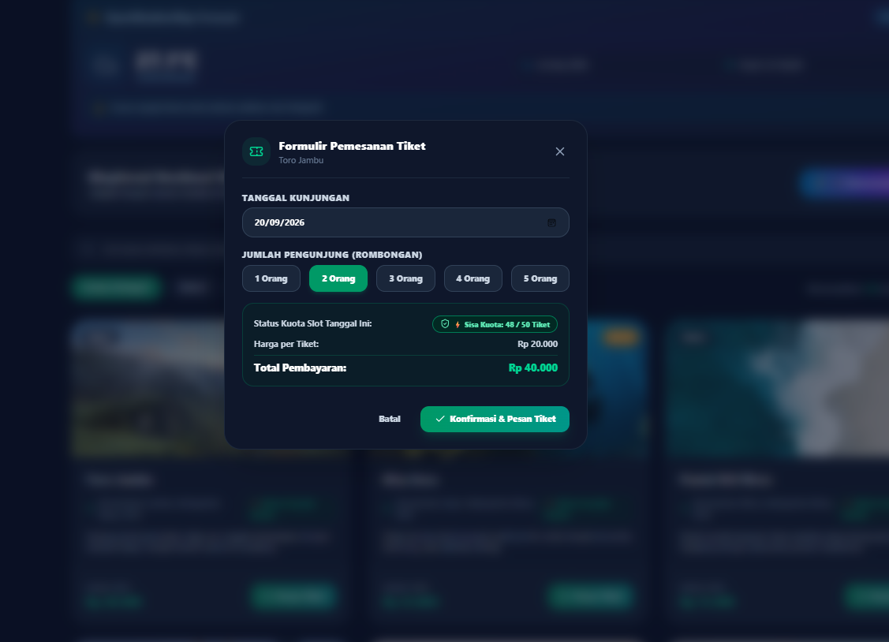
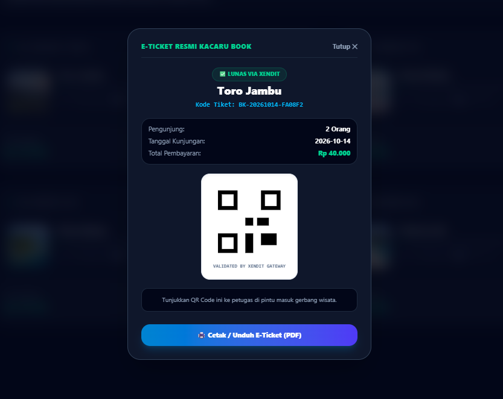
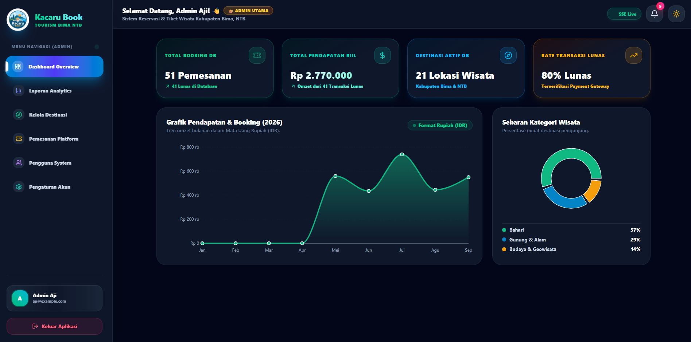
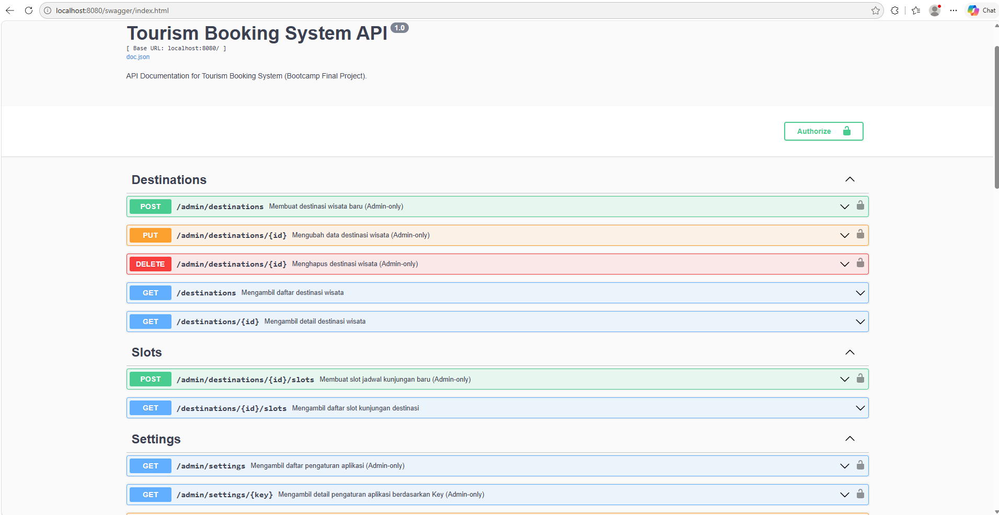
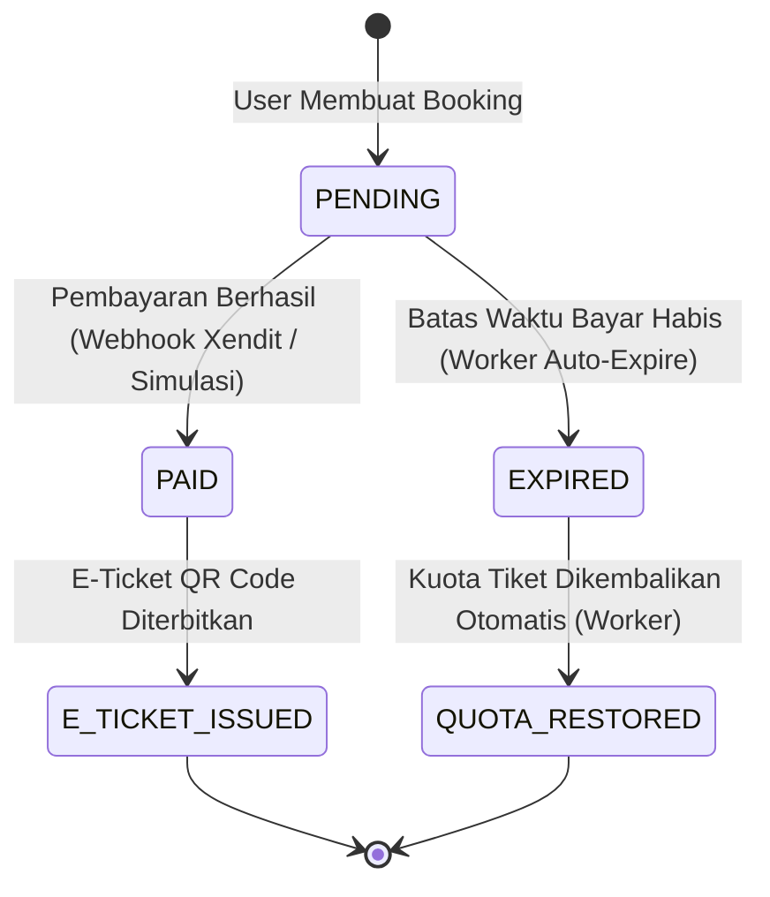

# 🌴 Tourism Booking System — Sistem Reservasi Tempat Wisata Digital


> 👨‍💻 **Pengembang (Developer):** **Aji Wardiman**  
> 🎓 **Status Proyek:** Tugas Akhir Backend Golang Batch 2  
> 🔗 **Repositori:** [Kacaru Book](https://github.com/AjiWardiman/kacaru-book)

---

## 🔗 DOKUMEN & MEDIA PROYEK

Berikut adalah tautan resmi dokumen perancangan, slide presentasi, dan rekaman video demo aplikasi **Tourism Booking System (Kacaru Book)**:

- 🎨 **Entity Relationship Diagram (ERD):** [Lihat ER Diagram Kacaru Book (Google Drive)](https://drive.google.com/file/d/18pCFW9baf46Ih-uB5w8gMmOBebhcUE6p/view?usp=drive_link)
- 📊 **Slide Presentasi (PPT):** [Lihat Presentation Slide Kacaru Book (Google Slides)](https://docs.google.com/presentation/d/1xMfge3mo1Qsj4tdgSVCFg1z3gZwIddN-/edit?usp=drive_link&ouid=103647142140848675436&rtpof=true&sd=true)
- 🎥 **Video Rekaman Demo Web:** [Tonton Video Demo Web Kacaru Book (Google Drive)](https://drive.google.com/file/d/1d9S-iIJGm-hRSf_4dwSbm_cHXEUjP5kK/view?usp=drive_link)

---

## 📸 PRATINJAU ANTARMUKA APLIKASI (SCREENSHOTS)

Berikut adalah galeri tangkapan layar tampilan antarmuka sistem **Tourism Booking System (Kacaru Book)**:

| 1. Katalog Wisata & Cuaca Realtime | 2. Menu Autentikasi Akun & Login |
| :---: | :---: |
|  |  |

| 3. Asisten Rekomendasi AI (Claude) | 4. Pemesanan Tiket & Kuota Slot |
| :---: | :---: |
|  |  |

| 5. E-Ticket Digital dengan QR Code | 6. Dashboard Analytics Admin |
| :---: | :---: |
|  |  |

### ⚡ Dokumentasi REST API (Swagger UI)


---

## 📌 DAFTAR ISI
1. [Dokumen & Media Proyek](#-dokumen--media-proyek)
2. [Pratinjau Antarmuka Aplikasi (Screenshots)](#-pratinjau-antarmuka-aplikasi-screenshots)
3. [Latar Belakang Proyek](#-latar-belakang-proyek)
4. [Fitur-Fitur Unggulan](#-fitur-fitur-unggulan)
5. [Arsitektur Sistem & Alur Data](#-arsitektur-sistem--alur-data)
6. [Status Integrasi Frontend & Backend](#-status-integrasi-frontend--backend)
7. [Tabel Dokumentasi API Endpoints](#-tabel-dokumentasi-api-endpoints)
8. [Skema Database (PostgreSQL)](#-skema-database-postgresql)
9. [Panduan Instalasi & Konfigurasi Environment](#-panduan-instalasi--konfigurasi-environment)
10. [Menjalankan dengan Docker](#-menjalankan-dengan-docker)
11. [Panduan Pengujian (Testing)](#-panduan-pengujian-testing)
12. [Panduan Presentasi & Demo Aplikasi](#-panduan-presentasi--demo-aplikasi)
13. [Profil Pengembang](#-profil-pengembang)

---

## 📖 LATAR BELAKANG PROYEK

**Tourism Booking System** adalah platform web terintegrasi yang dirancang untuk memodernisasi proses pemesanan tiket destinasi wisata. Platform ini menjawab berbagai tantangan klasik pada sistem reservasi konvensional, seperti risiko *overbooking* (bentrok kuota), ketidakpastian cuaca bagi wisatawan, hambatan pembayaran manual, serta ketiadaan analitik transaksi bagi pengelola wisata.

Sistem ini menggabungkan **Backend Golang** berkinerja tinggi berbasis arsitektur *Clean Architecture* (Handler → Service → Repository) dengan **Frontend React TypeScript** yang responsif, menyajikan pengalaman pengguna yang cepat, aman, dan estetik baik dalam mode terang (*Light Mode*) maupun gelap (*Dark Mode*).

---

## 🌟 FITUR-FITUR UNGGULAN

### 1. 🤖 AI Recommendation Engine (Pencocokan Cerdas)
- Menggunakan integrasi AI (OpenRouter API - Claude Model) untuk menganalisis anggaran (*budget*) dan kategori tempat wisata favorit wisatawan.
- Menghitung persentase kemiripan (*match score*) serta memberikan analisis rekomendasi kontekstual secara realtime.

### 2. 🌤️ OpenWeatherMap Forecast & Safety Warnings
- Menampilkan estimasi cuaca 5 hari ke depan pada detail destinasi wisata.
- Menyediakan peringatan keselamatan (*Safety Warnings*) otomatis jika kondisi cuaca diprediksi ekstrem/hujan badai.

### 3. 🔒 Kuota Tiket Anti-Bentrok (Database Row Locking)
- Menggunakan mekanisme penguncian baris database (`SELECT ... FOR UPDATE`) pada PostgreSQL.
- Menjamin konsistensi data kuota meskipun puluhan pengguna memesan tiket pada sisa kuota yang sama di waktu yang bersamaan (*high-concurrency safety*).

### 4. 💳 Integrasi Payment Gateway Xendit & E-Ticket Digital
- Menghasilkan invoice pembayaran otomatis via Xendit API.
- Mengonfirmasi pembayaran secara *asynchronous* melalui sistem Webhook berkeamanan token callback.
- Menerbitkan **E-Ticket ber-QR Code** instan yang siap diunduh/dicetak pengguna.

### 5. ⏳ Background Worker Auto-Expire & Rotasi Audit Log
- **Booking Expiry Worker:** Pekerja latar belakang (goroutine) yang memeriksa dan membatalkan booking kadaluarsa setiap 1 menit serta mengembalikan kuota otomatis.
- **Audit Log Retention Worker:** Merekam setiap perubahan data sensitif dan memutar log secara berkala (retensi 90 hari).

### 6. 📊 Dashboard Analytics & Export Laporan PDF/Excel
- Pengelola (Admin) dapat memantau pendapatan, jumlah pesanan, dan tingkat okupansi destinasi.
- Fitur pencetakan laporan keuangan dan pengunjung dalam format **PDF** dan **Excel** dengan satu kali klik.

### 7. 🔐 Otentikasi Berlapis & Verifikasi OTP
- Enkripsi kata sandi menggunakan `bcrypt`.
- Keamanan sesi API berbasis **JWT (JSON Web Token)**.
- Otentikasi OTP 6-digit untuk verifikasi akun dan perubahan data penting.

---

## 🚶‍♂️ ALUR PENGGUNA & CARA KERJA FITUR (USER JOURNEY & BUSINESS FLOW)

Berikut adalah rincian tahapan penggunaan aplikasi dari sudut pandang wisatawan mulai dari mencari tempat wisata hingga memegang E-Ticket digital:

```
[ 1. Browsing Katalog ] ➔ [ 2. Rekomendasi AI ] ➔ [ 3. Cek Cuaca Realtime ]
                                                             │
[ 6. Terbit E-Ticket QR ]  [ 5. Bayar Xendit ]  [ 4. Booking Anti-Bentrok ]
```

### 1. 📱 Browsing Katalog & Filter Destinasi
- Wisatawan menjelajahi katalog tempat wisata yang menyajikan foto berkualitas tinggi, harga tiket per orang, rating ulasan, serta lokasi geografis.
- Pencarian instan dan penyaringan berdasarkan kategori wisata (misal: *Bahari/Pantai*, *Gunung & Alam*, *Budaya & Geowisata*).

### 2. 🤖 Konsultasi dengan AI Rekomendasi Destinasi
- **Permasalahan:** Wisatawan kerap bingung memilih destinasi yang cocok dengan anggaran (*budget*) dan preferensi pribadi.
- **Solusi AI:** Wisatawan cukup menggeser batas maksimal harga tiket (misal: `Rp 50.000`) dan memilih kategori kesukaan.
- **Cara Kerja:** Sistem AI Asisten menganalisis seluruh data tempat wisata di database, menghitung tingkat kecocokan (*match score* dalam %), dan menuliskan alasan rekomendasi personal secara instan.

### 3. 🌤️ Pemeriksaan Ramalan Cuaca Realtime (OpenWeatherMap)
- **Permasalahan:** Wisatawan berisiko kecewa jika tiba di lokasi wisata outdoor saat cuaca buruk/hujan deras.
- **Solusi Cuaca:** Pada halaman detail destinasi, sistem secara otomatis mengambil ramalan cuaca realtime dari **OpenWeatherMap API**.
- **Saran Keselamatan:** Menampilkan estimasi suhu (`29.5°C`), kelembapan, kecepatan angin, serta catatan keselamatan otomatis (misal: *"Cuaca sangat ideal untuk wisata outdoor dan fotografi"*).

### 4. 🎫 Pemilihan Slot Tanggal & Pemesanan Tiket (Kuota Anti-Bentrok)
- Wisatawan memilih slot tanggal kunjungan dan jumlah tiket yang ingin dibeli.
- **Mekanisme Anti-Bentrok:** Saat tombol *"Pesan Sekarang"* diklik, backend Golang menjalankan algoritma *Database Row Locking* (`SELECT ... FOR UPDATE`). Kuota tiket dikunci dan dikurangi secara atomik, sehingga kuota tidak akan pernah minus/bentrok meskipun dipesan oleh puluhan wisatawan secara bersamaan.

### 5. 💳 Pembayaran Digital Instan (Xendit Gateway)
- Sistem membuatkan link invoice pembayaran resmi via **Xendit Payment Gateway** yang mendukung E-Wallet, QRIS, Virtual Account Bank, dan Kartu Kredit.
- **Konfirmasi Otomatis:** Setelah wisatawan selesai membayar, server Xendit mengirimkan sinyal *Webhook* aman ke backend untuk mengubah status transaksi menjadi **LUNAS (PAID)** secara otomatis tanpa perlu verifikasi transfer manual.

### 6. 📱 E-Ticket Digital ber-QR Code & Cetak PDF
- Setelah status bayar terkonfirmasi, wisatawan langsung menerima **E-Ticket Digital** di menu *"Tiket Saya"*.
- Tiket dilengkapi dengan **QR Code unik** yang siap ditunjukkan dan di-scan oleh petugas di pintu masuk tempat wisata, serta dapat diunduh/dicetak ke file PDF.

### 7. 📊 Pengelolaan & Analytics Pengelola (Admin Flow)
- Pengelola tempat wisata (Admin) memiliki akses ke Dashboard Analytics untuk melihat grafik pendapatan harian/bulanan dan persentase okupansi slot.
- Admin dapat mengunduh laporan keuangan dan rekapitulasi jumlah pengunjung dalam format **Excel (`.xlsx`)** dan **PDF (`.pdf`)** hanya dengan satu kali klik.

---

## 🏗️ ARSITEKTUR SISTEM & ALUR DATA

### 1. Diagram Arsitektur Aplikasi


### 2. Diagram Alur Transaksi & Pembayaran


---

## 🔄 STATUS INTEGRASI FRONTEND & BACKEND

Seluruh fitur backend telah selesai dibangun dan dapat diakses serta diuji secara penuh melalui **REST API** (terdokumentasi interaktif di [Swagger UI](http://localhost:8080/swagger/index.html) dan Insomnia Collection).

Berdasarkan hasil verifikasi pada antarmuka web (Frontend React), berikut adalah pemetaan status integrasi fitur:

### 1. ✅ Fitur Terintegrasi Penuh (Frontend Web & Backend API)
Fitur-fitur berikut telah memiliki antarmuka pengguna visual dan terhubung dengan backend:
- **Autentikasi & Verifikasi OTP:** Registrasi, Login pengguna/admin, dan modal verifikasi kode OTP 6-digit.
- **Katalog & Detail Destinasi:** Jelajah destinasi wisata, pencarian instan, filter kategori, dan modal detail informasi tempat wisata.
- **Prakiraan Cuaca Realtime (OpenWeatherMap):** Penampil ramalan cuaca, suhu, kelembapan, dan *safety warning* otomatis pada detail destinasi.
- **AI Recommendation Engine (OpenRouter):** Konsultasi pemilihan wisata berdasarkan anggaran (*budget*) dan kategori favorit via modal AI Asisten interaktif.
- **Pemesanan Tiket Anti-Bentrok:** Formulir pemesanan tiket pengunjung yang menjalankan *Database Row Locking* (`SELECT ... FOR UPDATE`).
- **Pembayaran Xendit & Simulasi Pelunasan:** Pembuatan invoice pembayaran serta modal simulasi pelunasan langsung di web.
- **E-Ticket Digital (QR Code):** Halaman "Tiket Saya" yang menampilkan status lunas dan tiket digital ber-QR Code siap unduh/cetak.
- **Dashboard Analytics Admin:** Panel ringkasan statistik total pendapatan, jumlah transaksi, dan visualisasi grafik performa bisnis.
- **Export Laporan Transaksi (PDF & Excel):** Tombol "Export Excel" (`.xlsx`) dan "Export PDF" (`.pdf`) pada menu Laporan Admin yang langsung memicu unduhan berkas laporan dari backend.
- **CRUD Destinasi oleh Admin:** Antarmuka formulir tambah, edit, dan hapus tempat wisata untuk pengguna ber-role Administrator.
- **Manajemen Pemesanan & Pengguna:** Tabel monitoring data reservasi tiket serta manajemen data akun pengguna platform.

### 2. ⏳ Hanya Tersedia via REST API / Swagger (Belum Ada Tampilan di Frontend)
Fitur-fitur berikut telah selesai dan siap diuji secara penuh di backend via Swagger / REST API, namun belum memiliki antarmuka khusus (*dedicated UI*) di frontend:
- **Pengelolaan & Monitoring Slot Kuota oleh Admin (`POST /admin/destinations/:id/slots`):**  
  - **Tampilan Utama Web (Katalog):** Pada kartu destinasi saat membuka web, angka jumlah kuota slot **tidak ditampilkan** (hanya berlabel indikator umum *"⚡ Kuota Tersedia Harian"*, karena kuota bersifat dinamis per tanggal kunjungan pada tabel `slots`).
  - **Modal Pemesanan Tiket:** Sisa kuota baru dicek dan dimuat secara dinamis via API (`GET /destinations/:id/slots`) ketika wisatawan membuka formulir modal pemesanan tiket untuk memilih tanggal.
  - **Panel Admin:** Belum tersedia formulir antarmuka bagi admin untuk menambah, mengubah, atau menutup slot kuota tanggal secara mandiri di web (pengelolaan slot admin sepenuhnya dilakukan via REST API / Swagger atau diinisialisasi melalui *seeder* database).
- **Manajemen Master Kategori Destinasi (`categories` & `destination_categories`):**  
  Pada frontend, kategori destinasi saat ini dipilih melalui dropdown/filter statis pada form destinasi; belum tersedia halaman CRUD khusus bagi admin untuk mengelola data entitas master tabel kategori secara mandiri.
- **Inspeksi Log Audit & Pengaturan Sistem Dinamis (`audit_logs` & `settings`):**  
  Fitur pencatatan riwayat audit perubahan data sensitif serta konfigurasi durasi sistem beroperasi secara otomatis di tingkat backend/database tanpa panel visual khusus di frontend.
- **Pekerja Latar Belakang Otomatis (Background Worker):**  
  Goroutine *Booking Expiry Worker* (otomatis membatalkan pesanan kadaluarsa & memulihkan kuota) dan *Audit Log Retention Worker* bekerja di latar belakang sistem tanpa memerlukan tindakan di antarmuka web.

---

## 📋 TABEL DOKUMENTASI API ENDPOINTS

| Kategori | Method | Endpoint | Akses | Deskripsi |
| :--- | :---: | :--- | :---: | :--- |
| **Auth** | `POST` | `/auth/register` | Publik | Pendaftaran akun pengguna baru |
| **Auth** | `POST` | `/auth/login` | Publik | Login pengguna & penerbitan token JWT |
| **Auth** | `POST` | `/auth/send-otp` | Publik | Permintaan pengiriman kode OTP 6-digit |
| **Destinasi** | `GET` | `/destinations` | Publik | Menampilkan daftar katalog tempat wisata |
| **Destinasi** | `GET` | `/destinations/:id` | Publik | Detail tempat wisata & informasi cuaca |
| **Slot** | `GET` | `/destinations/:id/slots` | Publik | Daftar slot tanggal & sisa kuota tiket |
| **Fitur AI** | `POST` | `/recommendations` | Publik | Mengambil rekomendasi AI berdasarkan budget |
| **Booking** | `POST` | `/bookings` | Auth User | Membuat pesanan tiket baru (Row Locking) |
| **Booking** | `GET` | `/bookings/my-bookings` | Auth User | Menampilkan daftar tiket milik pengguna |
| **Payment** | `POST` | `/bookings/:id/pay` | Auth User | Membuat link pembayaran Xendit Invoice |
| **Webhook** | `POST` | `/webhooks/xendit` | Xendit System | Webhook penerimaan status bayar dari Xendit |
| **Admin** | `POST` | `/admin/destinations` | Admin | Tambah destinasi wisata baru |
| **Admin** | `PUT` | `/admin/destinations/:id` | Admin | Perbarui data destinasi wisata |
| **Admin** | `DELETE` | `/admin/destinations/:id` | Admin | Hapus destinasi wisata |
| **Admin** | `POST` | `/admin/destinations/:id/slots` | Admin | Tambah slot kuota tanggal kunjungan |
| **Admin** | `GET` | `/admin/reports/summary` | Admin | Ringkasan laporan analytics pendapatan |
| **Admin** | `GET` | `/admin/reports/export/excel` | Admin | Unduh laporan transaksi format `.xlsx` |
| **Admin** | `GET` | `/admin/reports/export/pdf` | Admin | Unduh laporan transaksi format `.pdf` |

---

## 🗄️ SKEMA DATABASE (POSTGRESQL)

Database `tourism_booking` terdiri dari 13 tabel utama (didefinisikan pada `backend/migrations/001_init.sql`):
1. `users` — Data akun pengguna & admin (Nama, Email, No HP, Phone Verified, Password Hash, Role).
2. `categories` — Kategori destinasi wisata (Nama Kategori, Deskripsi, Status Aktif).
3. `destinations` — Data tempat wisata (Nama, Lokasi, Deskripsi, Kategori, Harga, Gambar, Status Aktif, Admin Pembuat).
4. `destination_categories` — Tabel relasi *many-to-many* antara destinasi dan kategori.
5. `slots` — Slot jadwal kunjungan harian per destinasi (Tanggal, Kuota Total, Kuota Terpakai, Status Ketersediaan).
6. `bookings` — Data pemesanan tiket (User ID, Slot ID, Kode Booking, Total Pengunjung, Total Harga, Status, Expired At).
7. `booking_details` — Detail data setiap pengunjung dalam rombongan booking (Nama Pengunjung, No HP, Email, Usia).
8. `payments` — Data transaksi pembayaran Xendit (Booking ID, External ID, Invoice ID, Jumlah, Metode Bayar, Status, URL Bayar).
9. `payment_events` — Log rekaman peristiwa callback/webhook dari Xendit (Payment ID, Event Type, Payload JSON).
10. `audit_logs` — Rekam jejak aktivitas audit perubahan data (User ID, Aksi, Nama Tabel, Record ID, Nilai Lama & Baru).
11. `settings` — Pengaturan konfigurasi dinamis aplikasi (Batas waktu expired booking, batas OTP, email kontak).
12. `notifications` — Notifikasi sistem pengguna (User ID, Tipe, Judul, Pesan, Status Dibaca).
13. `otps` — Penyimpanan kode OTP verifikasi 6-digit berbatas waktu (User ID, Kode, Tujuan, Status Penggunaan, Expired At).

---

## 🛠️ PANDUAN INSTALASI & KONFIGURASI ENVIRONMENT

### 1. Persyaratan Sistem
- **Go** v1.25 atau yang lebih baru (sesuai `backend/go.mod`)
- **Node.js** v18 atau yang lebih baru
- **PostgreSQL** v14 atau yang lebih baru

### 2. Pengaturan Environment Variable (`backend/.env`)
Buat file `backend/.env` (atau salin dari `.env.example`):
```env
APP_PORT=8080

DB_HOST=localhost
DB_PORT=5432
DB_USER=postgres
DB_PASSWORD=your_password
DB_NAME=tourism_booking
DB_SSLMODE=disable

JWT_SECRET=supersecretjwtkey_tourism_2026

MAILTRAP_HOST=sandbox.smtp.mailtrap.io
MAILTRAP_PORT=2525
MAILTRAP_USERNAME=your_mailtrap_user
MAILTRAP_PASSWORD=your_mailtrap_pass
MAIL_FROM_ADDRESS=no-reply@tourism-booking.local

XENDIT_SECRET_KEY=xnd_development_dummykey
XENDIT_CALLBACK_TOKEN=xnd_callback_dummytoken
XENDIT_BASE_URL=

OPENROUTER_API_KEY=your_openrouter_api_key
OPENROUTER_MODEL=anthropic/claude-3-haiku
```

### 3. Langkah Menjalankan Aplikasi

#### A. Backend (Golang)
```bash
# Masuk ke folder backend
cd backend

# Download dependensi Go
go mod tidy

# Jalankan server
go run ./cmd/api
```
*Server API berjalan di `http://localhost:8080`.*

#### B. Frontend (React + Vite)
```bash
# Masuk ke folder web
cd web

# Install dependensi npm
npm install

# Jalankan mode pengembangan
npm run dev
```
*Aplikasi Web berjalan di `http://localhost:5173`.*

---

## 🐳 MENJALANKAN DENGAN DOCKER

Proyek ini telah dikonfigurasi penuh dengan dukungan Docker dan Docker Compose untuk kemudahan deployment satu perintah (*one-command setup*) tanpa perlu menginstal Go, Node.js, maupun PostgreSQL secara manual di komputer lokal.

### 🏗️ Arsitektur Container
1. **`db` (PostgreSQL 16 Alpine):** Database utama dengan persistent volume (`db_data`), healthcheck otomatis (`pg_isready`), dan inisialisasi skema awal otomatis dari `backend/migrations/001_init.sql`.
2. **`backend` (Golang 1.25 Multi-stage):** Di-build secara statis tanpa CGO menggunakan image builder Go 1.25 Alpine, kemudian dijalankan pada runtime Alpine Linux minimal yang ringan dan aman. Terkonfigurasi menunggu service `db` dalam status *healthy*.
3. **`web` (React + Vite + Nginx):** Di-build menjadi berkas statis produksi menggunakan Node.js 20 Alpine, lalu disajikan menggunakan server web Nginx Alpine yang menangani routing SPA (Single Page Application) dan reverse proxy.

### 🚀 Langkah Menjalankan dengan Docker

1. **Siapkan File Environment (`.env`):**
   Salin berkas template `.env.example` di root menjadi `.env` **sebelum** menjalankan Docker Compose (agar kredensial database dan API key terbaca):
   ```bash
   cp .env.example .env
   ```
   *(Pada Windows PowerShell: `Copy-Item .env.example .env`)*

2. **Jalankan Seluruh Service Menggunakan Docker Compose:**
   ```bash
   docker compose up --build
   ```
   *Atau jalankan di latar belakang (detached mode):*
   ```bash
   docker compose up --build -d
   ```

3. **Inisialisasi Data Demo / Seeder (Opsional tapi Direkomendasikan):**
   Setelah semua container berjalan, isi database dengan destinasi wisata, slot kuota, dan akun pengguna bawaan:
   ```bash
   docker exec -it tourism_backend /app/seed
   ```

4. **Akses Layanan:**
   - 🌐 **Web Frontend (Nginx):** [http://localhost:3000](http://localhost:3000)
   - ⚡ **Backend API Server:** [http://localhost:8080](http://localhost:8080)
   - 📑 **Swagger API Docs:** [http://localhost:8080/swagger/index.html](http://localhost:8080/swagger/index.html)
   - 🗄️ **PostgreSQL Database:** `localhost:5432`

5. **Mematikan Service:**
   ```bash
   docker compose down
   ```
   *Jika ingin menghapus volume data database:*
   ```bash
   docker compose down -v
   ```

#### 🔑 Akun Bawaan Seeder (Untuk Pengujian / Demo App)
Setelah seeder dijalankan (`go run ./cmd/seed` atau `docker exec tourism_backend /app/seed`), Anda dapat login menggunakan kredensial demo berikut:

| Peran (Role) | Email | Kata Sandi (Password) | Hak Akses Utama |
| :--- | :--- | :--- | :--- |
| 👑 **Administrator** | `aji@example.com` | `password123` | Akses penuh Dashboard Admin, Analytics, Kelola Destinasi, Pemesanan Platform, & Kelola Users |
| 👤 **Customer** | `budi@example.com` | `password123` | Jelajah Wisata, AI Rekomendasi, Pemesanan Tiket, Payment Xendit, & E-Ticket QR Code |
| 👤 **Customer Alternatif** | `user1@example.com` | `password123` | Pengujian transaksi & notifikasi riwayat pemesanan pelanggan |

---

## 🧪 PANDUAN PENGUJIAN (TESTING)

### 1. Menjalankan Unit Test Backend
```bash
cd backend
go test ./...
```

### 2. Menjalankan Type Check & E2E Testing Frontend
```bash
cd web
# Checking TypeScript Types
npx tsc --noEmit

# Running Playwright E2E Test
npm run test:e2e
```

---

## 📑 PANDUAN PRESENTASI & DEMO APLIKASI
Untuk alur demonstrasi praktis, script penjelasan di depan penguji, serta tangkisan pertanyaan Q&A, silakan baca file **[PANDUAN_DEMO.md](file:///e:/Golang/tugas-akhir/tourism-booking/PANDUAN_DEMO.md)**.

---

## 👤 PROFIL PENGEMBANG

<div align="center">

### **Aji Wardiman**
*Junior Backend Developer (Go)*

**Tugas Akhir Backend Golang Batch 2**  
Teknologi: Golang, Gin, GORM, PostgreSQL, React 19, TypeScript, Tailwind CSS.

---
*Dikembangkan dengan dedikasi tinggi untuk menyajikan kualitas perangkat lunak terbaik.*

</div>
