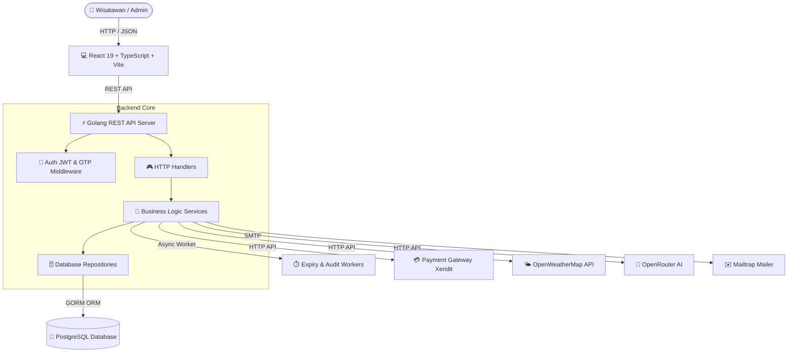
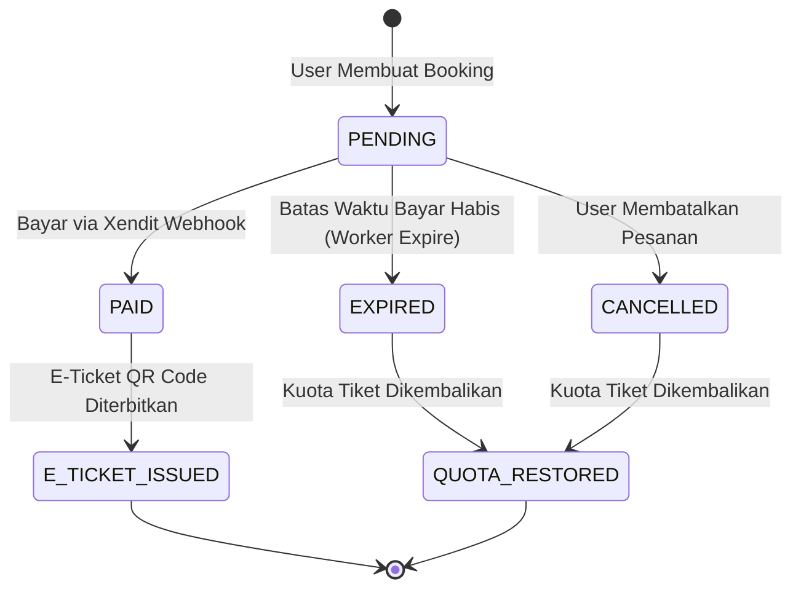

# 🌴 Tourism Booking System — Sistem Reservasi Tempat Wisata Digital


> 👨‍💻 **Pengembang (Developer):** **Aji Wardiman**  
> 🎓 **Status Proyek:** Tugas Akhir Bootcamp Backend Golang & Web Application  
> 🔗 **Repositori:** [Kacaru Book](https://github.com/AjiWardiman/kacaru-book)

---

## 🔗 DOKUMEN & MEDIA PROYEK

Berikut adalah tautan resmi dokumen perancangan, slide presentasi, dan rekaman video demo aplikasi **Tourism Booking System (Kacaru Book)**:

- 🎨 **Entity Relationship Diagram (ERD):** [Lihat ER Diagram Kacaru Book (Google Drive)](https://drive.google.com/file/d/18pCFW9baf46Ih-uB5w8gMmOBebhcUE6p/view?usp=drive_link)
- 📊 **Slide Presentasi (PPT):** [Lihat Presentation Slide Kacaru Book (Google Slides)](https://docs.google.com/presentation/d/1xMfge3mo1Qsj4tdgSVCFg1z3gZwIddN-/edit?usp=drive_link&ouid=103647142140848675436&rtpof=true&sd=true)
- 🎥 **Video Rekaman Demo Web:** [Tonton Video Demo Web Kacaru Book (Google Drive)](https://drive.google.com/file/d/1d9S-iIJGm-hRSf_4dwSbm_cHXEUjP5kK/view?usp=drive_link)

---

## 📌 DAFTAR ISI
1. [Dokumen & Media Proyek](#-dokumen--media-proyek)
2. [Latar Belakang Proyek](#-latar-belakang-proyek)
3. [Fitur-Fitur Unggulan](#-fitur-fitur-unggulan)
4. [Arsitektur Sistem & Alur Data](#-arsitektur-sistem--alur-data)
5. [Tabel Dokumentasi API Endpoints](#-tabel-dokumentasi-api-endpoints)
6. [Skema Database (PostgreSQL)](#-skema-database-postgresql)
7. [Panduan Instalasi & Konfigurasi Environment](#-panduan-instalasi--konfigurasi-environment)
8. [Panduan Pengujian (Testing)](#-panduan-pengujian-testing)
9. [Panduan Presentasi & Demo Sidang](#-panduan-presentasi--demo-sidang)
10. [Profil Pengembang](#-profil-pengembang)

---

## 📖 LATAR BELAKANG PROYEK

**Tourism Booking System** adalah platform web terintegrasi yang dirancang untuk memodernisasi proses pemesanan tiket destinasi wisata. Platform ini menjawab berbagai tantangan klasik pada sistem reservasi konvensional, seperti risiko *overbooking* (bentrok kuota), ketidakpastian cuaca bagi wisatawan, hambatan pembayaran manual, serta ketiadaan analitik transaksi bagi pengelola wisata.

Sistem ini menggabungkan **Backend Golang** berkinerja tinggi berbasis arsitektur *Clean Architecture* (Handler → Service → Repository) dengan **Frontend React TypeScript** yang responsif, menyajikan pengalaman pengguna yang cepat, aman, dan estetik baik dalam mode terang (*Light Mode*) maupun gelap (*Dark Mode*).

---

## 🌟 FITUR-FITUR UNGGULAN

### 1. 🤖 AI Recommendation Engine (Pencocokan Cerdas)
- Menggunakan integrasi AI (OpenRouter API - Claude Model) untuk menganalisis anggaran (*budget*) dan kategori tempat wisata favorit wisatawan.
- Menghitung persentase kemiripan (*match score*) serta memberikan analisis rekomendasi kontekstual secara realtime.

### 2. 🌤️ OpenWeatherMap Forecast & Safety Warnings
- Menampilkan estimasi cuaca 5 hari ke depan pada detail destinasi wisata.
- Menyediakan peringatan keselamatan (*Safety Warnings*) otomatis jika kondisi cuaca diprediksi ekstrem/hujan badai.

### 3. 🔒 Kuota Tiket Anti-Bentrok (Database Row Locking)
- Menggunakan mekanisme penguncian baris database (`SELECT ... FOR UPDATE`) pada PostgreSQL.
- Menjamin konsistensi data kuota meskipun puluhan pengguna memesan tiket pada sisa kuota yang sama di waktu yang bersamaan (*high-concurrency safety*).

### 4. 💳 Integrasi Payment Gateway Xendit & E-Ticket Digital
- Menghasilkan invoice pembayaran otomatis via Xendit API.
- Mengonfirmasi pembayaran secara *asynchronous* melalui sistem Webhook berkeamanan token callback.
- Menerbitkan **E-Ticket ber-QR Code** instan yang siap diunduh/dicetak pengguna.

### 5. ⏳ Background Worker Auto-Expire & Rotasi Audit Log
- **Booking Expiry Worker:** Pekerja latar belakang (goroutine) yang memeriksa dan membatalkan booking kadaluarsa setiap 1 menit serta mengembalikan kuota otomatis.
- **Audit Log Retention Worker:** Merekam setiap perubahan data sensitif dan memutar log secara berkala (retensi 90 hari).

### 6. 📊 Dashboard Analytics & Export Laporan PDF/Excel
- Pengelola (Admin) dapat memantau pendapatan, jumlah pesanan, dan tingkat okupansi destinasi.
- Fitur pencetakan laporan keuangan dan pengunjung dalam format **PDF** dan **Excel** dengan satu kali klik.

### 7. 🔐 Otentikasi Berlapis & Verifikasi OTP
- Enkripsi kata sandi menggunakan `bcrypt`.
- Keamanan sesi API berbasis **JWT (JSON Web Token)**.
- Otentikasi OTP 6-digit untuk verifikasi akun dan perubahan data penting.

---

## 🚶‍♂️ ALUR PENGGUNA & CARA KERJA FITUR (USER JOURNEY & BUSINESS FLOW)

Berikut adalah rincian tahapan penggunaan aplikasi dari sudut pandang wisatawan mulai dari mencari tempat wisata hingga memegang E-Ticket digital:

```
[ 1. Browsing Katalog ] ➔ [ 2. Rekomendasi AI ] ➔ [ 3. Cek Cuaca Realtime ]
                                                             │
[ 6. Terbit E-Ticket QR ]  [ 5. Bayar Xendit ]  [ 4. Booking Anti-Bentrok ]
```

### 1. 📱 Browsing Katalog & Filter Destinasi
- Wisatawan menjelajahi katalog tempat wisata yang menyajikan foto berkualitas tinggi, harga tiket per orang, rating ulasan, serta lokasi geografis.
- Pencarian instan dan penyaringan berdasarkan kategori wisata (misal: *Bahari/Pantai*, *Gunung & Alam*, *Budaya & Geowisata*).

### 2. 🤖 Konsultasi dengan AI Rekomendasi Destinasi
- **Permasalahan:** Wisatawan kerap bingung memilih destinasi yang cocok dengan anggaran (*budget*) dan preferensi pribadi.
- **Solusi AI:** Wisatawan cukup menggeser batas maksimal harga tiket (misal: `Rp 50.000`) dan memilih kategori kesukaan.
- **Cara Kerja:** Sistem AI Asisten menganalisis seluruh data tempat wisata di database, menghitung tingkat kecocokan (*match score* dalam %), dan menuliskan alasan rekomendasi personal secara instan.

### 3. 🌤️ Pemeriksaan Ramalan Cuaca Realtime (OpenWeatherMap)
- **Permasalahan:** Wisatawan berisiko kecewa jika tiba di lokasi wisata outdoor saat cuaca buruk/hujan deras.
- **Solusi Cuaca:** Pada halaman detail destinasi, sistem secara otomatis mengambil ramalan cuaca realtime dari **OpenWeatherMap API**.
- **Saran Keselamatan:** Menampilkan estimasi suhu (`29.5°C`), kelembapan, kecepatan angin, serta catatan keselamatan otomatis (misal: *"Cuaca sangat ideal untuk wisata outdoor dan fotografi"*).

### 4. 🎫 Pemilihan Slot Tanggal & Pemesanan Tiket (Kuota Anti-Bentrok)
- Wisatawan memilih slot tanggal kunjungan dan jumlah tiket yang ingin dibeli.
- **Mekanisme Anti-Bentrok:** Saat tombol *"Pesan Sekarang"* diklik, backend Golang menjalankan algoritma *Database Row Locking* (`SELECT ... FOR UPDATE`). Kuota tiket dikunci dan dikurangi secara atomik, sehingga kuota tidak akan pernah minus/bentrok meskipun dipesan oleh puluhan wisatawan secara bersamaan.

### 5. 💳 Pembayaran Digital Instan (Xendit Gateway)
- Sistem membuatkan link invoice pembayaran resmi via **Xendit Payment Gateway** yang mendukung E-Wallet, QRIS, Virtual Account Bank, dan Kartu Kredit.
- **Konfirmasi Otomatis:** Setelah wisatawan selesai membayar, server Xendit mengirimkan sinyal *Webhook* aman ke backend untuk mengubah status transaksi menjadi **LUNAS (PAID)** secara otomatis tanpa perlu verifikasi transfer manual.

### 6. 📱 E-Ticket Digital ber-QR Code & Cetak PDF
- Setelah status bayar terkonfirmasi, wisatawan langsung menerima **E-Ticket Digital** di menu *"Tiket Saya"*.
- Tiket dilengkapi dengan **QR Code unik** yang siap ditunjukkan dan di-scan oleh petugas di pintu masuk tempat wisata, serta dapat diunduh/dicetak ke file PDF.

### 7. 📊 Pengelolaan & Analytics Pengelola (Admin Flow)
- Pengelola tempat wisata (Admin) memiliki akses ke Dashboard Analytics untuk melihat grafik pendapatan harian/bulanan dan persentase okupansi slot.
- Admin dapat mengunduh laporan keuangan dan rekapitulasi jumlah pengunjung dalam format **Excel (`.xlsx`)** dan **PDF (`.pdf`)** hanya dengan satu kali klik.

---

## 🏗️ ARSITEKTUR SISTEM & ALUR DATA

### 1. Diagram Arsitektur Aplikasi


### 2. Diagram Alur Transaksi & Pembayaran


---

## 📋 TABEL DOKUMENTASI API ENDPOINTS

| Kategori | Method | Endpoint | Akses | Deskripsi |
| :--- | :---: | :--- | :---: | :--- |
| **Auth** | `POST` | `/auth/register` | Publik | Pendaftaran akun pengguna baru |
| **Auth** | `POST` | `/auth/login` | Publik | Login pengguna & penerbitan token JWT |
| **Auth** | `POST` | `/auth/send-otp` | Publik | Permintaan pengiriman kode OTP 6-digit |
| **Destinasi** | `GET` | `/destinations` | Publik | Menampilkan daftar katalog tempat wisata |
| **Destinasi** | `GET` | `/destinations/:id` | Publik | Detail tempat wisata & informasi cuaca |
| **Slot** | `GET` | `/destinations/:id/slots` | Publik | Daftar slot tanggal & sisa kuota tiket |
| **Fitur AI** | `POST` | `/recommendations` | Publik | Mengambil rekomendasi AI berdasarkan budget |
| **Booking** | `POST` | `/bookings` | Auth User | Membuat pesanan tiket baru (Row Locking) |
| **Booking** | `GET` | `/bookings/my-bookings` | Auth User | Menampilkan daftar tiket milik pengguna |
| **Payment** | `POST` | `/bookings/:id/pay` | Auth User | Membuat link pembayaran Xendit Invoice |
| **Webhook** | `POST` | `/webhooks/xendit` | Xendit System | Webhook penerimaan status bayar dari Xendit |
| **Admin** | `POST` | `/admin/destinations` | Admin | Tambah destinasi wisata baru |
| **Admin** | `PUT` | `/admin/destinations/:id` | Admin | Perbarui data destinasi wisata |
| **Admin** | `DELETE` | `/admin/destinations/:id` | Admin | Hapus destinasi wisata |
| **Admin** | `POST` | `/admin/destinations/:id/slots` | Admin | Tambah slot kuota tanggal kunjungan |
| **Admin** | `GET` | `/admin/reports/summary` | Admin | Ringkasan laporan analytics pendapatan |
| **Admin** | `GET` | `/admin/reports/export/excel` | Admin | Unduh laporan transaksi format `.xlsx` |
| **Admin** | `GET` | `/admin/reports/export/pdf` | Admin | Unduh laporan transaksi format `.pdf` |

---

## 🗄️ SKEMA DATABASE (POSTGRESQL)

Database `tourism_booking` terdiri dari 13 tabel utama:
1. `users` — Data pengguna (Nama, Email, Phone, Password Hash, Role, Email Verified).
2. `destinations` — Data tempat wisata (Nama, Deskripsi, Lokasi, Harga, Rating, Gambar).
3. `slots` — Slot kunjungan harian per destinasi (Tanggal, Kuota Maksimal, Terpaksa).
4. `bookings` — Data pemesanan (User ID, Slot ID, Kode Booking, Total Harga, Status).
5. `payments` — Data invoice pembayaran Xendit (Invoice ID, Payment URL, Channel).
6. `payment_events` — Log peristiwa webhook pembayaran Xendit.
7. `notifications` — Notifikasi sistem pengguna (Judul, Pesan, Status Dibaca).
8. `audit_logs` — Rekam jejak aktivitas perubahan data sensitif oleh pengguna/admin.
9. `settings` — Pengaturan dinamis aplikasi (Masa berlaku OTP, dsb).
10. `otps` — Penyimpanan kode OTP verifikasi berbatas waktu.

---

## 🛠️ PANDUAN INSTALASI & KONFIGURASI ENVIRONMENT

### 1. Persyaratan Sistem
- **Go** v1.20 atau yang lebih baru
- **Node.js** v18 atau yang lebih baru
- **PostgreSQL** v14 atau yang lebih baru

### 2. Pengaturan Environment Variable (`backend/.env`)
Buat file `backend/.env` (atau salin dari `.env.example`):
```env
APP_PORT=8080

DB_HOST=localhost
DB_PORT=5432
DB_USER=postgres
DB_PASSWORD=your_password
DB_NAME=tourism_booking
DB_SSLMODE=disable

JWT_SECRET=supersecretjwtkey_tourism_2026

MAILTRAP_HOST=sandbox.smtp.mailtrap.io
MAILTRAP_PORT=2525
MAILTRAP_USERNAME=your_mailtrap_user
MAILTRAP_PASSWORD=your_mailtrap_pass
MAIL_FROM_ADDRESS=no-reply@tourism-booking.local

XENDIT_SECRET_KEY=xnd_development_dummykey
XENDIT_CALLBACK_TOKEN=xnd_callback_dummytoken
XENDIT_BASE_URL=

OPENROUTER_API_KEY=your_openrouter_api_key
OPENROUTER_MODEL=anthropic/claude-3-haiku
```

### 3. Langkah Menjalankan Aplikasi

#### A. Backend (Golang)
```bash
# Masuk ke folder backend
cd backend

# Download dependensi Go
go mod tidy

# Jalankan server
go run ./cmd/api
```
*Server API berjalan di `http://localhost:8080`.*

#### B. Frontend (React + Vite)
```bash
# Masuk ke folder web
cd web

# Install dependensi npm
npm install

# Jalankan mode pengembangan
npm run dev
```
*Aplikasi Web berjalan di `http://localhost:5173`.*

---

## 🧪 PANDUAN PENGUJIAN (TESTING)

### 1. Menjalankan Unit Test Backend
```bash
cd backend
go test ./...
```

### 2. Menjalankan Type Check & E2E Testing Frontend
```bash
cd web
# Checking TypeScript Types
npx tsc --noEmit

# Running Playwright E2E Test
npm run test:e2e
```

---

## 📑 PANDUAN PRESENTASI & DEMO SIDANG
Untuk alur demonstrasi praktis, script penjelasan di depan penguji, serta tangkisan pertanyaan Q&A sidang, silakan baca file **[PANDUAN_DEMO.md](file:///e:/Golang/tugas-akhir/tourism-booking/PANDUAN_DEMO.md)**.

---

## 👤 PROFIL PENGEMBANG

<div align="center">

### **Aji Wardiman**
*Fullstack Software Engineer / Golang & React Developer*

**Tugas Akhir Bootcamp Tourism Booking System**  
Teknologi: Golang, Gin, GORM, PostgreSQL, React 19, TypeScript, Tailwind CSS.

---
*Dikembangkan dengan dedikasi tinggi untuk menyajikan kualitas perangkat lunak terbaik.*

</div>
