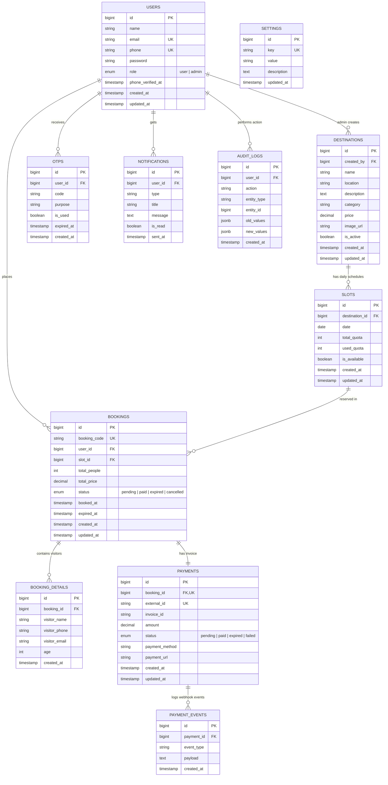

# Entity Relationship Diagram (ERD) - Tourism Booking System Bima

Dokumen ini berisi struktur Entity Relationship Diagram (ERD) berbasis PostgreSQL yang dirancang dan diimplementasikan untuk aplikasi **Tourism Booking System Kabupaten Bima**.

---

## 📐 Diagram ERD (Mermaid)

---

## 🔗 Penjelasan Relasi Entitas (Kardinalitas)

1. **`USERS` ➔ `DESTINATIONS` (1 : N)**
   - Satu pengguna berinisial Admin (`role = 'admin'`) dapat mendaftarkan dan mengelola banyak destinasi wisata.

2. **`DESTINATIONS` ➔ `SLOTS` (1 : N)**
   - Satu destinasi wisata memiliki banyak slot jadwal kunjungan harian (`date`, `total_quota`, `used_quota`).

3. **`USERS` & `SLOTS` ➔ `BOOKINGS` (1 : N)**
   - Seorang wisatawan (`user_id`) dapat memesan banyak tiket (`BOOKINGS`).
   - Setiap pemesanan dikaitkan dengan satu slot tanggal (`slot_id`) yang mengurangi `used_quota` pada slot tersebut.

4. **`BOOKINGS` ➔ `BOOKING_DETAILS` (1 : N)**
   - Satu kode pemesanan (`BOOKINGS`) dapat berisi 1 sampai banyak pengunjung rombongan (`BOOKING_DETAILS`), menyimpan nama, nomor HP, email, dan usia pengunjung.

5. **`BOOKINGS` ➔ `PAYMENTS` (1 : 1)**
   - Setiap satu pemesanan (`BOOKINGS`) memiliki TEPAT SATU invoice transaksi pembayaran (`PAYMENTS`) via Xendit Payment Gateway.

6. **`PAYMENTS` ➔ `PAYMENT_EVENTS` (1 : N)**
   - Setiap pembayaran mencatat riwayat log perubahan event callback webhook Xendit (seperti `PAID`, `EXPIRED`, `FAILED`).

7. **`USERS` ➔ `OTPS`, `NOTIFICATIONS`, `AUDIT_LOGS` (1 : N)**
   - Satu pengguna dapat memiliki banyak log kode OTP, notifikasi penerimaan tiket, dan rekam audit aktivitas sistem.
